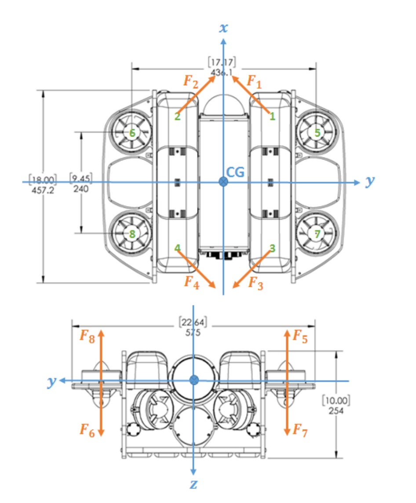

.. _ros2_control_RA5BHS_hil_setupdoc:

Hardware-in-the-Loop Setup
==========================

Overview
--------

This page is for hardware-specific setup notes. General workspace
installation, Python dependencies, and simulator launch checks live in
:doc:`installation`.

Prerequisites
-------------

- BlueOS must be running on ``aarch64``.
- Install the BlueOS ROS 2 extension on the vehicle companion computer.
- Apply the configuration settings from the
  `BlueOS ROS 2 extension thread <https://discuss.bluerobotics.com/t/blueos-ros2-extension-v0-0-2-is-here/19324/5?u=mrrobot_1>`_.

Launch Direction
----------------

Use the hardware launch arguments only when the corresponding hardware is
connected and configured:

.. code-block:: shell

   ros2 launch ros2_control_blue_reach_5 robot_system_multi_interface.launch.py \
       use_manipulator_hardware:=true \
       use_vehicle_hardware:=true \
       sim_robot_count:=0 \
       task:=interactive

Mixed hardware/simulation launches use the same launch file with one hardware
flag enabled and the other disabled.

BlueROV Thruster Mapping and Sign Check
---------------------------------------

Before closed-loop vehicle tests, verify that the BlueROV thruster channel
mapping and forward/reverse directions match the convention implemented by the
vehicle hardware interface. The framework assumes the thruster numbering and
positive force directions shown below.

Use the direct-thruster keyboard task for the in-water check. See
:ref:`direct_thruster_keyboard_task` for the launch command and key mapping.
Test one thruster channel at a time before running any vehicle feedback
controller:

- The keyboard channel drives the physical thruster with the same number as
  the diagram.
- Positive and negative commands produce thrust in the expected forward/reverse
  directions.

If a keyboard channel drives the wrong physical thruster, fix the BlueROV
thruster output mapping before running feedback control. If a thruster spins in
the wrong forward/reverse direction, use the thruster ``direction`` parameter in
``description/ros2_control/vehicle_system_multi_interface.ros2_control.xacro``.
Set it to ``1`` or ``-1`` for the affected thruster so the physical
forward/reverse direction agrees with the diagram. Incorrect mapping or
reversed thrust signs will make the vehicle controller apply the wrong body
wrench.

Architecture & HIL Presentation
-------------------------------

Arm augmented disturbance EKF (shadow commissioning)
~~~~~~~~~~~~~~~~~~~~~~~~~~~~~~~~~~~~~~~~~~~~~~~~~~~~

The Reach hardware driver now runs the same generated 12-state coupled arm
disturbance EKF as simulation (e, d, c, b; the gripper is excluded). It exports
the same 112 arm GPIO fields, including disturbance means, variances, validity,
and nominal model parameters. The nominal model is shared in
``nominal_arm_parameters.hpp``; existing controller-facing state filters and
actuator commands are unchanged during commissioning.

This is **estimation-only**, not validated physical disturbance compensation.
``estimator_disturbance_observable.*`` remains zero on hardware to prevent the
DR controller from admitting this posterior. In the demo layout the zero status
therefore also means "hardware shadow mode", not necessarily physical contact.
Use ``estimator_valid`` to decide whether a displayed estimate is current.
No simulator injection or contact-truth topic is used by this hardware observer.

The observer uses measured motor current converted by the existing calibrated
current-to-torque map, never commanded effort. Each position/velocity/current
field of all four joints must advance before an update. Receive-time skew is
limited to 50 ms, age to 150 ms, and prediction intervals to 100 ms. These are
host receive timestamps, not synchronized device acquisition timestamps.
The interval input is the endpoint average of measured torque. A dropout or
invalid numerical result invalidates and re-seeds the observer. Repeated reads
of the same serial feedback do not reduce its covariance.

Within 0.01 rad of an existing Xacro joint bound, the estimate is marked invalid:
the real mechanical stop reaction is unknown. No new joint limits are defined.
After release the filter re-seeds. An interior stall, gearbox friction or an
external constraint cannot be uniquely identified as external load from these
signals alone. The nominal gravity assumes the current fixed model orientation;
base motion, payload and calibration mismatch can appear in the disturbance.

Commissioning procedure:

1. Rebuild and restart the hardware launch; verify the startup SHADOW warning.
2. Subscribe PlotJuggler to ``/dynamic_joint_states`` and regenerate bindings for
   that launch. Simulator injection curves are not measured hardware truth.
3. With the arm supported and clear of stops, verify position/current signs,
   units, sample timing, and ``estimator_valid`` before interpreting torque.
4. Record unloaded and independently measured known-load trials in both signs.
   Calibrate the current map, nominal friction/payload and measurement noise.
5. Keep compensation disabled until physical tests establish accuracy and safe
   controller admission. Software tests do not establish hardware readiness.

For a detailed walkthrough of the hardware architecture and HIL test setup,
consult the slide deck:

`Architecture & HIL Presentation <https://lsumail2-my.sharepoint.com/:p:/g/personal/emorg31_lsu_edu/EZNXdx-t7KlGj5Qo0V1qlxQBU7RX0Y2PIy5yE-KyVJcoLg?e=94xglK>`_
