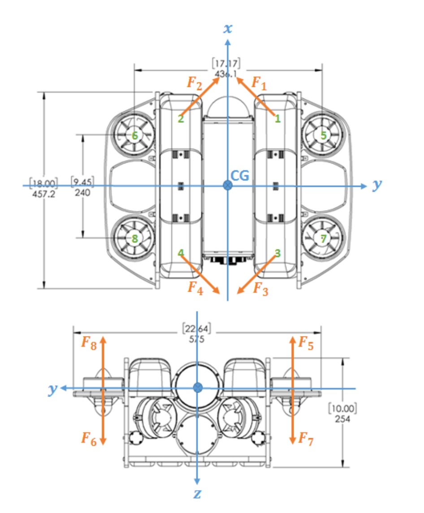

.. _ros2_control_RA5BHS_hil_setupdoc:

Hardware-in-the-Loop Setup
==========================

Install and build the workspace first; see :doc:`installation`.

Sensor Mounts
-------------

The vehicle Xacro declares the camera and DVL mounts. The fixed
``<prefix>dvl_joint`` connects ``<prefix>base_link`` to ``<prefix>dvl_link``;
``robot_state_publisher`` publishes this transform for both simulated and real
vehicles. Adjust the DVL origin in the selected vehicle's Xacro when calibrating
its mounting pose. The vehicle drivers do not broadcast a second DVL mount.

Prerequisites
-------------

- BlueOS must be running on ``aarch64``.
- Install the BlueOS ROS 2 extension on the vehicle companion computer.
- Apply the configuration settings from the
  `BlueOS ROS 2 extension thread <https://discuss.bluerobotics.com/t/blueos-ros2-extension-v0-0-2-is-here/19324/5?u=mrrobot_1>`_.

Launch Hardware
---------------

Use the hardware launch arguments only when the corresponding hardware is
connected and configured:

.. code-block:: shell

   ros2 launch ros2_control_blue_reach_5 robot_system_multi_interface.launch.py \
       use_manipulator_hardware:=true \
       use_vehicle_hardware:=true \
       sim_robot_count:=0 \
       task:=interactive

Pass ``serial_port:=/dev/ttyUSB1`` to select a known arm device; the default
``auto`` searches serial-by-ID, USB and ACM devices.

Mixed hardware/simulation launches use the same launch file with one hardware
flag enabled and the other disabled.

Driver transport behavior
-------------------------

The arm transport validates COBS framing, CRC and packet size before dispatch.
Receive/disconnect and transmit failures latch until reconnection; arm command
writes report a hardware error when the transport fails. Reconfiguring the arm
retains one feedback subscription per packet type. Serial writes still use
blocking I/O, so backpressure can delay command delivery and shutdown.

The DVL transport skips malformed JSON or sensor messages and limits each input
frame to 64 KiB. EOF or an oversized frame stops the connection; an explicit
restart joins the old reader before reconnecting. Automatic reconnection and a
connection deadline are not implemented. Sensor timestamp resets still require
reconfiguration of the vehicle interface. Offline PTY and loopback tests cover
these transport behaviors; they do not establish physical device timing.

BlueROV Thruster Mapping and Sign Check
---------------------------------------

Before closed-loop tests, check thruster numbering and force direction against
this diagram.

Use the direct-thruster keyboard task for the in-water check. See
:ref:`direct_thruster_keyboard_task` for the launch command and key mapping.
Test one thruster channel at a time before running any vehicle feedback
controller:

- The keyboard channel drives the physical thruster with the same number as
  the diagram.
- Positive and negative commands produce thrust in the expected forward/reverse
  directions.

If a keyboard channel drives the wrong physical thruster, fix the BlueROV
thruster output mapping before running feedback control. If a thruster spins in
the wrong forward/reverse direction, use the thruster ``direction`` parameter in
``description/ros2_control/vehicle_system_multi_interface.ros2_control.xacro``.
Set it to ``1`` or ``-1`` to match the diagram.

Arm disturbance EKF
-------------------

The hardware observer uses fresh joint position, velocity and current-derived
torque for joints e, d, c and b. It runs in shadow mode: disturbance compensation
is disabled and ``estimator_disturbance_observable.*`` remains zero. Check
``estimator_valid`` for freshness; it does not establish physical accuracy.
Its numerical update runs in a worker with one pending snapshot, outside the
200 Hz hardware read callback. New snapshots replace pending ones rather than
building a backlog. Integration still uses the serial sample timestamps; repeated
packets are not assimilated twice. Completed diagnostics are copied without waiting
and invalidated after 150 ms of feedback age. Activation/deactivation joins and
restarts the worker so a previous session cannot publish a late result. The
controller-facing joint filters remain in the read callback.

Calibrate current-to-torque conversion and verify known-load recordings before
using estimates. Joint stops invalidate observations.

Architecture & HIL Presentation
-------------------------------

For a detailed walkthrough of the hardware architecture and HIL test setup,
consult the slide deck:

`Architecture & HIL Presentation <https://lsumail2-my.sharepoint.com/:p:/g/personal/emorg31_lsu_edu/EZNXdx-t7KlGj5Qo0V1qlxQBU7RX0Y2PIy5yE-KyVJcoLg?e=94xglK>`_

Controller-facing arm feedback freshness
----------------------------------------

The physical arm's kinematic filter predicts on each hardware read. Position and
velocity corrections each require a new serial receipt timestamp; repeated reads
of the same packet do not provide new evidence. The hardware uses
``ekf_update_fresh`` from ``libmEKF_next.so``, generated alongside the synchronous
filter in ``Floating-KinDyn-Graph/usage/joint_ekf.ipynb``. Build and restart the
hardware process together when updating this export and its caller.

This corrects a repeated-measurement defect that reproduced original Ours
oscillation in a nominal multirate test. It does not change Ours' gains or law,
enable shadow-observer compensation, or relax missing-feedback faults. The current controller adapters are described in simlab's
``docs/oges_settling.rst``. Physical performance requires a fresh recording
after restart.

Arm current-derived effort
--------------------------

For the four physical arm joints, ``effort`` is the estimated motor torque
``measured_current / kt``. Here the configured ``kt`` has units of current per
joint torque. This estimate includes nonzero motor effort at rest; it does not
subtract the configured static-friction current. Friction and external load are
not measured by the current sensor and cannot be inferred as a deadband.
Identification and the shadow observer receive this same motor-effort estimate.
Its accuracy still depends on torque/current calibration; it is not a torque
sensor measurement. Mechanical-power estimates using this field inherit that
limitation and do not represent electrical consumption.

``computed_effort`` remains the requested controller effort. The existing
hardware command map can add a static-current offset, so requested effort and
current-derived motor effort need not match. This telemetry correction does not
change that command map, controller gains, current limits or gripper behavior.
The idealized moving-branch net-torque conversion remains used by the simulated
actuator, where its friction loss is an explicit model assumption.

Controller timing and simulation faults
------------------------------------------

Feedback controllers use elapsed time between their own callbacks, not the
arm's published ``sim_period`` (which may be zero at reset). Timer and interval
use steady time normally and ROS time with ``use_sim_time=true``, matching the
controller manager clock policy. The first callback establishes the origin;
backward/zero intervals or gaps over the existing 0.5 second feedback freshness
budget fault execution instead of silently integrating a discontinuity. This
is an admission bound, not a claim of stability for arbitrary sample intervals.
Timing continues while idle/paused, so Execute does not integrate idle time.
Vehicle, arm, hold and reference replay share this interval. PID arm validates
it before mutating its integral; Ours load adaptation consumes the same supplied
interval. Recorded kinematics includes ``controller_interval_sec`` separately
from plant telemetry.

On control exceptions (including arm hold), feedback loss or command-controller
loss, commands are stopped and simulated components are requested to pause.
``pause_sim_vehicle`` and ``pause_sim_manipulator`` hold commands and freeze
physics without resetting plant state. A completed observation is consumed
exactly once even if pause arrives between write and read; a new write cannot
overwrite it. The vehicle stores the completed step's duration separately from
pause-updated telemetry, as the arm already does.

Simulation capabilities come from the launch configuration, independently of
the interactive gate. Physical components never receive simulation requests.
Ungated Robot execution stays held after a fault until explicit reset/release.
The interactive gate waits for pause acknowledgements and requires an explicit
execution action to resume. A failed pause leaves execution blocked and logs
the failure; it cannot guarantee physics has stopped if the service is absent.

Release requests have a two-second steady-time response deadline. Partial
failure and Stop during release trigger compensating pauses. Transaction tokens
prevent old acknowledgements from authorizing a newer execution or clearing a
newer pause/reset barrier. Late release replies trigger another pause because
cancelling a local future cannot revoke server execution. These independent ROS
services are not an atomic multi-component release: transient movement before
compensation remains possible under delayed communication. Normal Stop after a
completed release still stops commands without freezing physics.

Validation covers the standard native simulator with the interactive backend,
gated/ungated and mixed-component fault dispatch, and native
write/pause/read/release orderings. No physical motion was used. Native active
plant steps reject nonpositive periods before integration. A paused component
can retain/reset telemetry without advancing physics.

The audited Python timing/transition functions have 304/304 executable
statements and 116/116 branch exits covered, without exclusions. The exact
scope, source hashes and raw coverage are recorded in
``diagnostics/execution_transition_audit``; this is not whole-repository or
physical-system coverage.

The batch/RL backend has a separate explicit-step contract. CPU and CUDA GPU
validation covers invalid timestep rejection without mutation, positive steps,
held physics with logical-time advancement, release through actions, reset,
malformed state/action rejection, and serialized concurrent Python steps.
GPU mutation validation precedes state changes, and synchronous GPU steps retain
the Python GIL through device completion. External CUDA pointer users must
synchronize their own accesses. The ROS batch wrapper converts invalid periods
and integration exceptions into hardware ERROR instead of unwinding the manager.
It does not provide interactive per-component pause services.

Real /clock timer tests cover 0.5x, 1x, 2x and 5x, paused clocks, backward jumps
and excessive forward jumps. A full native ROS-time launch also completed first
Execute, clock pause and resume at those rates. However, the accelerated test
did not sustain the nominal 150 Hz controller rate at 2x/5x (199/50 command pairs
per approximately two ROS seconds). These are functional timing tests, not
accelerated tracking-performance certification; gaps below the 0.5 second
freshness budget do not themselves prove adequate control bandwidth.

Sensor transform ownership
--------------------------

Camera articulation is exported as ``camera_mount_joint/position``. The normal
and physical-scene robot state publishers use that joint with the selected
vehicle's URDF mount and optical frame; vehicle drivers publish only the base
pose. Both robot state publishers take their publication frequency from the
shared controller update rate. Hardware camera angle remains inferred from PWM,
not measured feedback.

The existing ``mocap_link`` denotes an external measurement reference, not a
robot-mounted marker. The launch owns its static map alignment through
``mocap_origin`` (x y z roll pitch yaw), preserving the previous default
``-0.170 0 0.200 0 0 0``. Calibrate this for the deployment. It is deliberately
not attached to the moving robot body.
