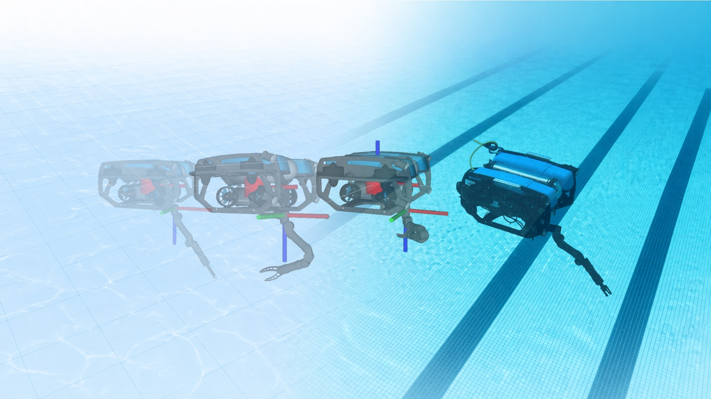

UVMS Project Documentation
==========================

Start with :doc:`installation` and :doc:`userdoc` to run a simulation.
:doc:`simlab_overview` explains how the simulator, SimLab and model sources fit
together.

.. toctree::
   :maxdepth: 1
   :caption: Getting Started

   simlab_overview
   installation
   userdoc
   hil_setup

.. toctree::
   :maxdepth: 1
   :caption: Operation

   controls_and_menus
   environment_scenes
   sensors_and_perception
   replay_and_experiments

.. toctree::
   :maxdepth: 1
   :caption: Reference and Development

   services_and_interfaces
   developer_guide
   rl_training
   license

.. toctree::
   :maxdepth: 1
   :caption: Project Links

   GitHub: uvms-simulator <https://github.com/edxmorgan/uvms-simulator>
   GitHub: uvms-simlab <https://github.com/edxmorgan/uvms-simlab>
   GitHub: Floating-KinDyn-Graph <https://github.com/edxmorgan/Floating-KinDyn-Graph>
   GitHub: diff_uv <https://github.com/edxmorgan/diff_uv>
