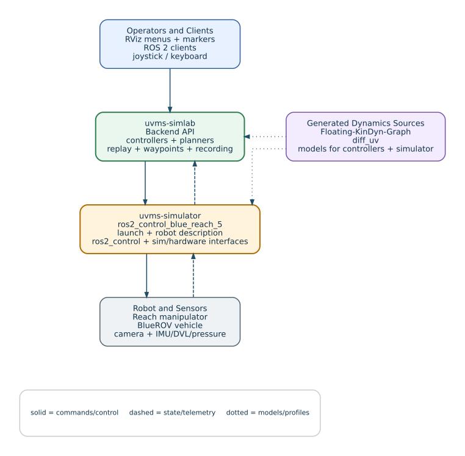

Project Overview
================

The UVMS stack combines a BlueROV vehicle and Reach Alpha manipulator under
ROS 2. The same high-level controls operate simulated, physical, and mixed
vehicle/manipulator configurations.

Packages
--------

- ``uvms-simulator`` (ROS package ``ros2_control_blue_reach_5``): robot
  descriptions, launch files, real and simulated hardware interfaces, and cameras.
- ``uvms-simlab`` (ROS package ``simlab``): controllers, planning, RViz
  interaction, teleoperation, replay, and experiment tools.

Where to start
--------------

Follow :doc:`installation`, then :doc:`userdoc` to run a first simulation.
Use :doc:`hil_setup` for hardware setup, :doc:`services_and_interfaces` for
scripting, and :doc:`developer_guide` to add controllers or other backends.
